# Báo cáo Codex — Luyện tư duy “Làm quen” (4–5 tuổi)

Nhánh `feat/web-app`, trên `f8834f9`. Chưa push, merge hoặc deploy. Chờ Claude G2/G3.

## Đã làm

- Thêm engine level 1 riêng cho 13 dạng được phép; `generate(type, 1, rng, {max:10})` từ chối loại khác. Level 2/3 giữ nguyên đường sinh bài.
- Mỗi câu có tối đa một ô trống, một đáp án xác định; số hiển thị trong 0–10, mọi phép cộng của level 1 có toán hạng và kết quả ≤5. Câu hỏi ngắn, dùng hình/chấm và lời giải đơn giản.
- Band 4–5 chỉ chơi level 1, mỗi lượt 5 câu. Bộ chọn ghi “Làm quen”; đáp án chạm tối thiểu 64px, “Khác loại” và “Vị trí” chạm trực tiếp vào hình. Không hiện dạng ngoài whitelist.
- Tiến bộ level 1 lưu ở `stats['l1:'+type]`, không nâng lên level 2. Review giữ nguyên item và `level`; chỉ hiện review của band đang chơi. Dạng `{stats, review}` và đường đồng bộ `learning/{profileId}_tuduy` không đổi.
- Learning Hub hiện Luyện tư duy cho 4–5; web `/tu-duy/?band=4-5` chọn sẵn nhóm đó, mặc định trang vẫn là 5–6; web app cho hồ sơ 4–5 mở đúng band. Không sửa Kotlin; APK debug đã chứa `assets/tuduy/tuduy-level1-core.js`.

## Kiểm tra

- `node --test shared/learning/tests/*.test.js`: **113/113** xanh, gồm 13 × 2.000 seed level 1, kiểm lại đáp án độc lập, biên số, độ dài câu hỏi và whitelist. 96 test cũ vẫn chạy.
- So với `f8834f9`, đầu ra level 2/3 **giống hệt JSON** ở 2.000 ca seed (mọi dạng, max 10/20 hợp lệ, extension bật).
- `npm --prefix web test`: **20/20** xanh. Chromium chơi đủ 5 câu của từng dạng ở 4–5; kiểm 320/360/412px không tràn ngang, đáp án ≥64px và không có request ra ngoài.
- `env JAVA_HOME=/Library/Java/JavaVirtualMachines/temurin-17.jdk/Contents/Home ./gradlew testDebugUnitTest assembleDebug`: **376/376** unit test Android xanh; build debug thành công.
- `git diff --check`: xanh.

Theo mục **Decision** trong task, chỉ assertion visibility cũ ở `tuduy-content.test.js` được đổi từ “5–6 trở lên” sang “4–5 trở lên”; test vẫn giữ kiểm tra nhóm 2–3 không được thấy Luyện tư duy. Đây là đổi quy tắc sản phẩm có chủ đích, không xoá hay nới các kiểm tra khác.

## Ảnh từng dạng (trang fixture 390×844)

| Dạng | Ảnh |
| --- | --- |
| Đếm hình (`shapes`) |  |
| So sánh (`compare`) |  |
| Sắp xếp (`order`) |  |
| Số liền kề (`neighbor`) |  |
| Quy luật dãy số (`sequence`) |  |
| Quy luật hình (`shapePattern`) |  |
| Khác loại (`oddOne`) |  |
| Vị trí (`position`) |  |
| Trong và ngoài (`insideOut`) |  |
| Nối cùng kết quả (`match`) |  |
| Đoàn tàu phép tính (`chain`) |  |
| Ô trống cân bằng (`balance`) |  |
| Sudoku nhí (`latin`) |  |

Ảnh dùng seed cố định 1729 trong `shared/learning/tests/tuduy-level1-screenshot.html`. G3 trên Pixel do Claude thực hiện sau review.

## Sửa theo G2 review `db0fcca`

- Hình/chấm đếm: ô **48×48px**, font **40px**; nhóm 6–10 xếp tối đa **5 ô/hàng**. Bài so sánh 10 và 8 hình tại 320px: [ảnh kiểm bố cục](tuduy-level1-screenshots/compare-ten-320.jpg), không tràn ngang. Kí hiệu quy luật và Sudoku font 40px; mũi tên font 28px; nút chạm tối thiểu 64px.
- Quy luật hình hiện 4–6 kí hiệu thay vì luôn 5; qua 2.000 seed, đáp án là kí hiệu đầu **1.108** lần, kí hiệu thứ hai **892** lần. Dãy số chọn bước đếm +1 khoảng 70%, hình khoảng 30%.
- Vị trí dùng “bên trái”, “bên phải”, “giữa”, “trên cùng”, “dưới cùng” trong câu hỏi và giải thích. Khác loại có thêm nhóm trái cây/con vật hoặc con vật/xe, vẫn đúng một hình khác.
- Đã xoá `.l1sheet.jpg` ở gốc worktree. File review của Claude và `docs/tasks/g3/` được giữ ngoài commit.

Kiểm tra lại: **113/113** JS shared, **20/20** web, **376/376** Android; `assembleDebug` và `git diff --check` đều đạt. Web test kiểm cỡ hình, mũi tên, vùng chạm, 320/360/412px không tràn; kiểm riêng nhóm 10 hình có đúng hai hàng 5.

Ảnh mới chụp ở viewport **320×640**, dùng full-page cho bài cần cuộn dọc:

| Dạng | Ảnh 320px |
| --- | --- |
| Đếm hình | 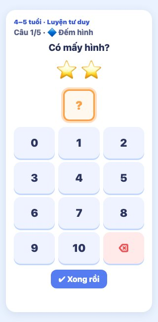 |
| So sánh | 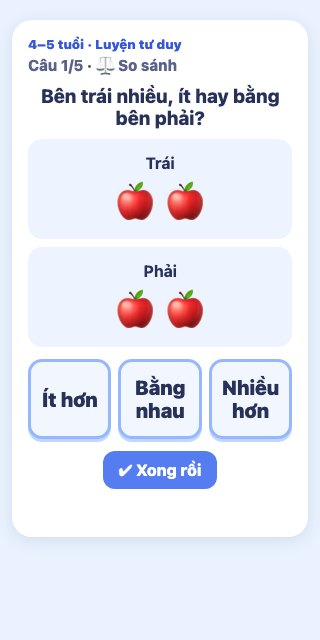 |
| Sắp xếp | 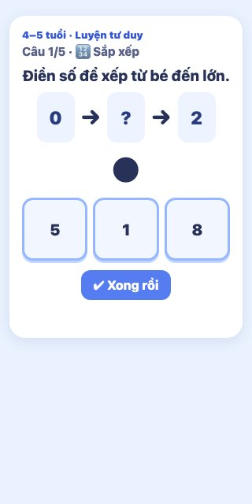 |
| Số liền kề | 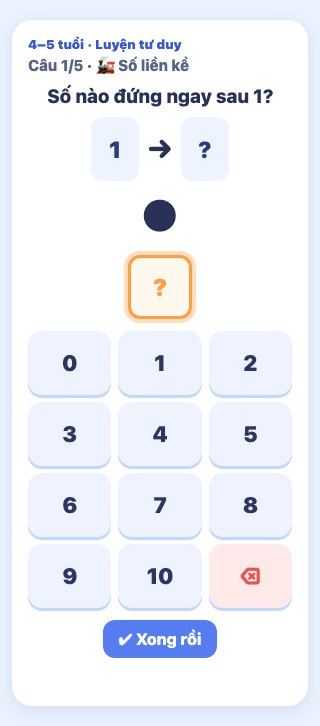 |
| Quy luật dãy số | 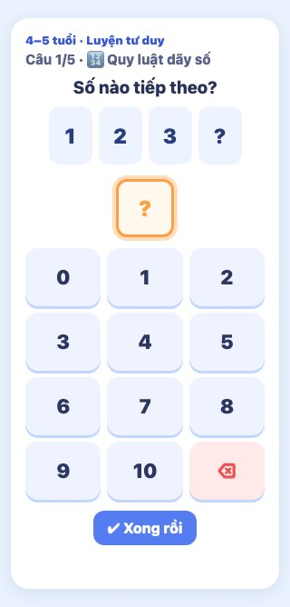 |
| Quy luật hình | 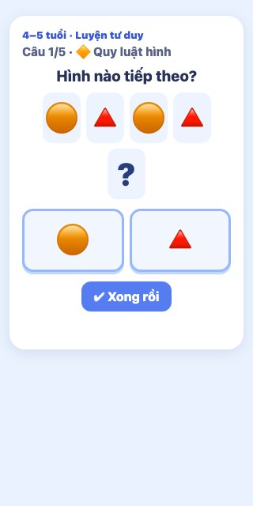 |
| Khác loại | 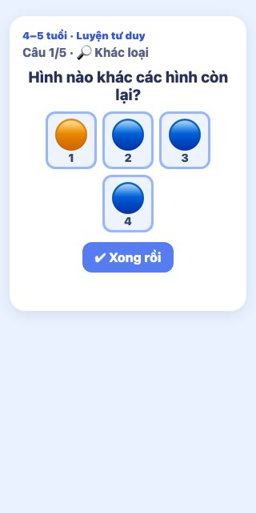 |
| Vị trí | 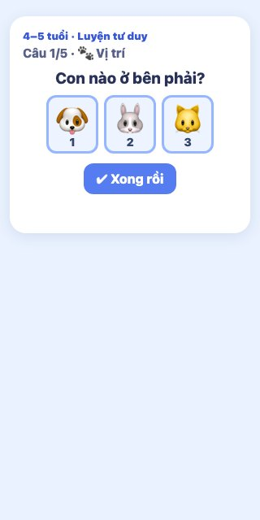 |
| Trong và ngoài | 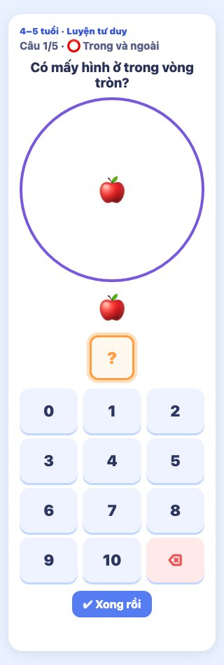 |
| Nối cùng kết quả | 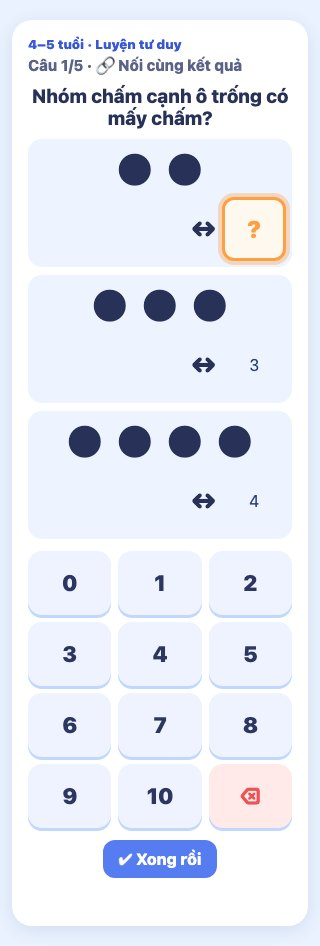 |
| Đoàn tàu phép tính | 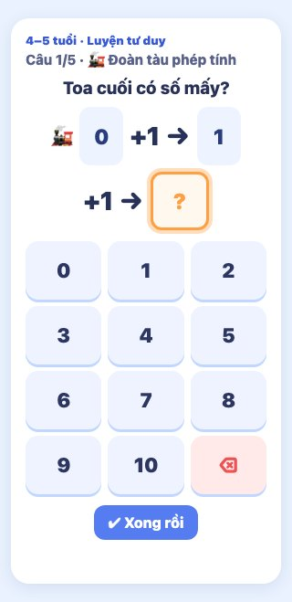 |
| Ô trống cân bằng | 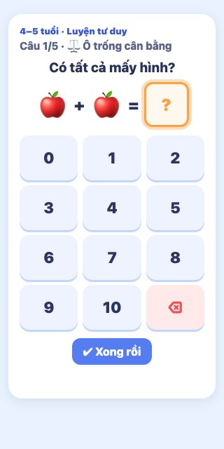 |
| Sudoku nhí | 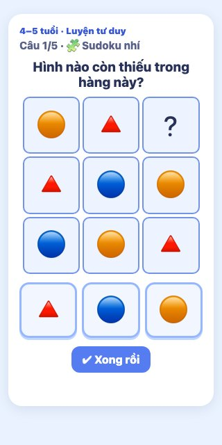 |

Ảnh 390×844 trong bảng phía trên cũng đã chụp lại sau khi sửa. Chưa push, merge hoặc deploy; chờ Claude review/G3.
